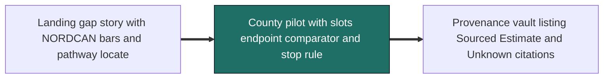
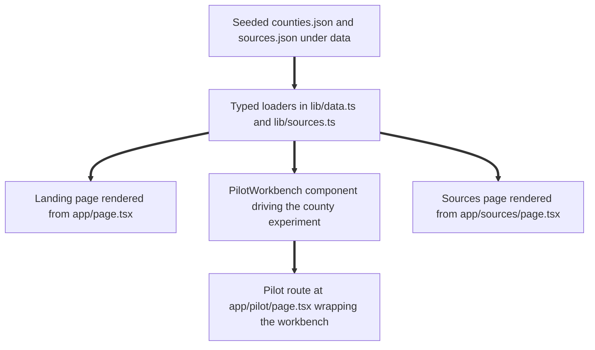

# Liwe

[](https://hackjunction.com/) [](https://nextjs.org/) [](https://www.typescriptlang.org/) [](https://react.dev/) [](#quickstart)

**County-experiment cockpit for Finnish lung-cancer pathway planning.** For wellbeing-services planners and county pathway leads: size a Satakunta-style primary-care CT pilot with a process clock, a comparator county, and a capacity stop rule before anyone announces the pathway.

Working software on `/`, `/pilot`, and `/sources` (seeded JSON, no auth). See [DEMO.md](DEMO.md).

> **Live:** *deploy URL TBD* · **Demo path:** [DEMO.md](DEMO.md) · **Cold brief:** [docs/Liwe-FI-brief.pdf](docs/Liwe-FI-brief.pdf)

| Ready now | What is implemented | Proof |
|---|---|---|
| Nordic survival gap | NORDCAN 5-year relative survival bars (men, lung C33–C34, 2020–2024): Finland **17.9%** vs Sweden **31.3%** | [`app/page.tsx`](app/page.tsx) · [`data/sources.json`](data/sources.json) (`nordcan`) |
| Referral gap locate | 4-step pathway; pulse on primary-care CT referral; treatment start marked unmeasured (clocks gap, not “no register”) | [`app/page.tsx`](app/page.tsx) · [REGISTER_COMPARE.md](REGISTER_COMPARE.md) |
| County pilot + stop rule | County picker, CT slots/week (Estimate), comparator, pre-registered endpoint, capacity ceiling that blocks announce | [`components/PilotWorkbench.tsx`](components/PilotWorkbench.tsx) · [`data/counties.json`](data/counties.json) · [DEMO.md](DEMO.md) |
| Provenance vault | Every citation row from seeded sources, with category tags | [`app/sources/page.tsx`](app/sources/page.tsx) · [`lib/sources.ts`](lib/sources.ts) |
| Evidence dial | Sourced / Estimate / Unknown tags next to figures | [`components/Provenance.tsx`](components/Provenance.tsx) |

## Screenshots

No captured PNGs in `docs/` yet. Run `npm run dev` and follow [DEMO.md](DEMO.md) (landing, then pilot, then sources). Backup stills for pitch: landing survival bars, Kainuu pilot, City of Helsinki capacity-blocked, sources vault.

## The problem

1. **Survival gap.** NORDCAN places Finnish men last in the Nordics for lung-cancer five-year relative survival (**17.9%**, 95% CI 16.7–19.2) against Sweden **31.3%** (30.0–32.7), diagnosed 2020–2024 ([`app/page.tsx`](app/page.tsx), `nordcan`).
2. **Referral rule.** Finnish health centres generally cannot send patients straight to CT; SE/DK/NO pathways build that filter step in (Acta 2025 survey; JTHO 2024; EU-JUST-CT). See [VERIFICATION.md](VERIFICATION.md).
3. **Missing clocks, not missing register.** FICAN/THL/FCR quality-registry pilot reports exist. Peers publish cancer-specific pathway day-clocks to treatment; Finland’s published lung tables still do not give a county manager “days from GP order to CT report.” See [REGISTER_COMPARE.md](REGISTER_COMPARE.md).

## What it does

1. Shows the Nordic survival gap with provenance, then pins the actionable system feature: the primary-care CT handoff.
2. Packages a **measured** county experiment (Satakunta-style route + process endpoint + comparator + stop rule), without a stage-shift promise.
3. Keeps every number tagged Sourced, Estimate, or Unknown, with a browsable sources vault.



## How it works

Static Next.js App Router app. Pages read precomputed JSON from `data/`. The demo stack ships without a database, an auth layer, or a live EHR connection.



Layout for a quick scan: `app/` holds `/`, `/pilot`, `/sources`; `components/` holds PilotWorkbench, Provenance, and nav; `lib/` loads typed seed JSON; `data/` is the demo source of truth (`counties.json`, `sources.json`); `docs/` has the cold brief PDF and docs map; `scripts/` and `raw/` are research pipelines and extracts (keep them; judges do not need them for the click path).

## Feature status

| Feature | How | Status |
|---|---|---|
| Landing gap + pathway locate | `/` | Working |
| County pilot (slots, comparator, endpoint, stop rule) | `/pilot` | Working |
| Capacity-blocked demo case | Helsinki over ceiling in `PilotWorkbench` | Working |
| Provenance vault | `/sources` + `data/sources.json` | Working |
| Evidence dial (Sourced / Estimate / Unknown) | `Provenance` tags | Working |
| Cold planning brief PDF | `docs/Liwe-FI-brief.pdf` | Working (static) |
| FI/EN toggle, print brief, optional LLM rephrase | not built | Roadmap |
| Live EHR / auth / Findata / patient triage | Explicit won’t-have | Out of scope |

## Quickstart

Install dependencies and start the Next.js development server, then open http://localhost:3000 and follow the click path in [DEMO.md](DEMO.md).

```bash
npm install && npm run dev   # local demo on port 3000
```

## Demo data

All interactive figures come from seeded JSON. There is no login.

| Asset | Role |
|---|---|
| [`data/counties.json`](data/counties.json) | Wellbeing-services counties: need rank, CT slots/week estimates, Satakunta precedent flag |
| [`data/sources.json`](data/sources.json) | Citation vault behind `/sources` and on-screen tags |
| Default pilot county | **Kainuu** (need #1 in seed) |
| Stop-rule trip | **City of Helsinki** (estimate above demo ceiling of 8 slots/week) |

Regenerate scripts live under `scripts/` (e.g. `gen_app_data.py`, `targeted_access.py`). Judges only need `npm run dev`.

## Safety

Prototype for population-level pathway planning at a hackathon. **Not a medical device.** It does not diagnose, score individual risk, advise on drugs or treatment, or use real patient records. Footer on every page: “Prototype, not a medical device.” Legal posture: [LEGAL.md](LEGAL.md).

## Limits (hackathon scope)

1. CT demand and stop-rule ceiling are **Estimates** for the recorded demo, not county capacity audits.
2. Satakunta is **unevaluated** local practice (press only); we do not claim stage shift or lives saved.
3. Causal “GP CT fixes survival” is **not** claimed (Guldbrandt 2015 RCT null; see [VERIFICATION.md](VERIFICATION.md)).
4. Sotkanet/NORDCAN are not called live on stage; figures are curated into seed files.
5. The repo does not yet ship a CI workflow or a public deploy URL.

## Docs map

Full index: [docs/DOCS_MAP.md](docs/DOCS_MAP.md). Short version:

| For judges | Files |
|---|---|
| **Start here** | This README · [DEMO.md](DEMO.md) · [BRAND.md](BRAND.md) · [docs/Liwe-FI-brief.pdf](docs/Liwe-FI-brief.pdf) |
| **Evidence** | [FINDING.md](FINDING.md) · [VERIFICATION.md](VERIFICATION.md) · [REGISTER_COMPARE.md](REGISTER_COMPARE.md) · [SOURCES.md](SOURCES.md) · [data/sources.json](data/sources.json) |
| **Product** | [MVP.md](MVP.md) · [DECISIONS.md](DECISIONS.md) · [DESIGN.md](DESIGN.md) |
| **Optional / internal** | IDEA, LEGAL, DIFFERENTIATION, DATA_SHEET, ROADMAP, HACKATHON, AGENTS, brief Markdown source, `scripts/`, `raw/` |

Do not delete research scripts or raw extracts; they back the seed. Ignore them for the demo path.

## Team

**NoTokens** (Junction 2026)

## License

[MIT](LICENSE). Copyright 2026 Team NoTokens.
