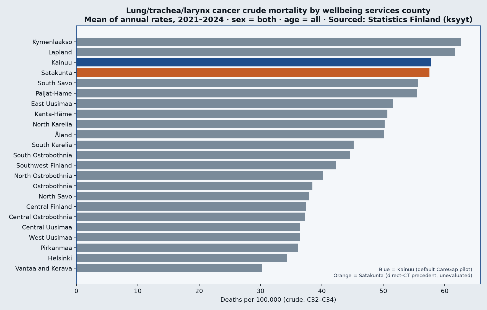
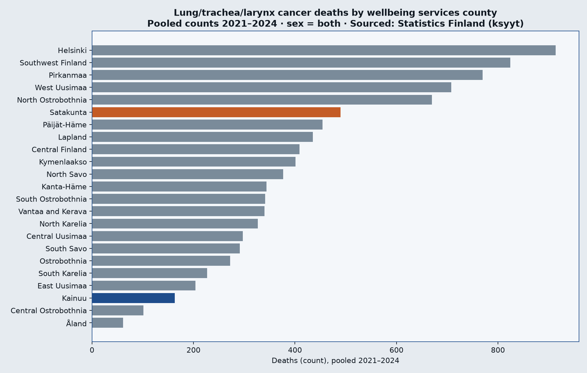
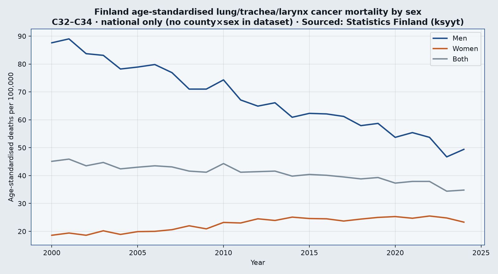
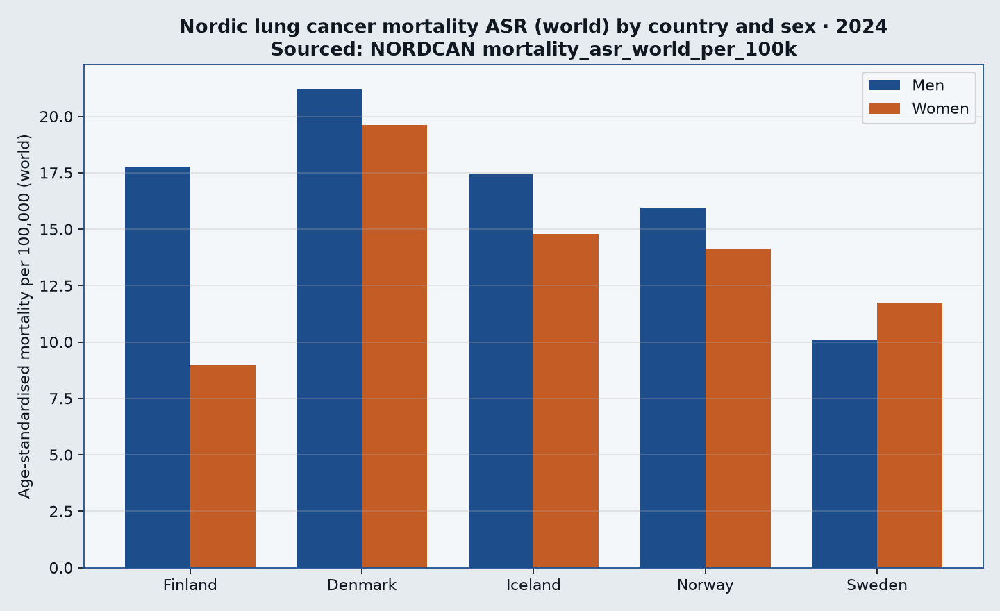
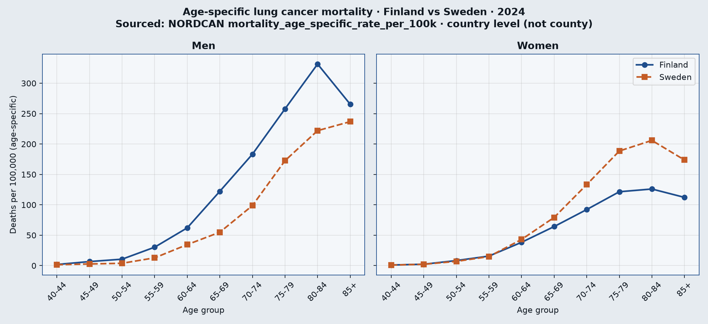

# Mortality charts (Sourced only)

Generated by `scripts/plot_mortality_charts.py` from `raw/deaths.csv` and `raw/nordcan.csv`.

## What the dataset can and cannot show

| Cut | Available? |
|---|---|
| County × **crude** mortality (both sexes, all ages) | **Yes** — Statistics Finland ksyyt C32–C34 |
| County × **death counts** | **Yes** |
| County × **sex** | **No** in this extract (county rows are sex = T only) |
| County × **age** | **No** |
| Finland × sex × **age-standardised** rate | **Yes** (national only) |
| Nordic country × sex × age-specific / ASR | **Yes** — NORDCAN |

So “as specific as possible” here means: **county totals** for Finland’s map, and **country × sex × age** for Nordic comparison — not county×age×gender (that table does not exist in our files).

## Charts

### 1. County crude mortality (rate)

### 2. County death counts (pooled)

### 3. Finland age-standardised mortality by sex (national)

### 4. Nordic ASR mortality by country and sex (2024)

### 5. Age-specific mortality Finland vs Sweden by sex (2024)

## Codes
- StatFin cause group: **C32–C34** (larynx + trachea + lung) — wider than lung-only.
- NORDCAN charts use NORDCAN lung mortality series as stored in `raw/nordcan.csv`.
